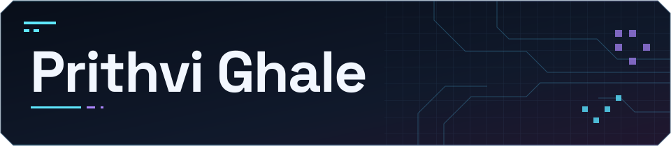

<h1 align="center"></h1>

  <picture>
    <source media="(prefers-reduced-motion: reduce)" srcset="assets/focus-still.svg">
    
  </picture>
  <picture>
    <source media="(prefers-reduced-motion: reduce)" srcset="assets/vending-machine-still.png">
    
  </picture>

## 👋 About me

I’m Prithvi Ghale, pursuing a Bachelor of Science in Computer Science at Southern New Hampshire University. I enjoy turning an idea into something people can use, from the first prototype to the details that make an app feel intuitive.

I’m interested in software engineering, full-stack development, generative AI, and machine learning. I like building for desktop, web, and mobile, with particular attention to the user experience.

## 📫 Connect with me

## 🛠️ Technology stack

### Programming languages

  
  
  
  
  
  
  
  
  

C# · C++ · Java · JavaScript · TypeScript · Python · HTML · CSS · SQL

### Frameworks and platforms

  
  
  
  
  
  
  

.NET / ASP.NET · React / React Native · Node.js · Firebase · Supabase · Unity · Android Studio

### Development tools

  
  
  
  

Git · GitHub · Visual Studio Code · Visual Studio 2022

## 🚀 Featured projects

<table>
  <tbody>
  <tr>
    <td width="72" align="center" valign="middle"></td>
    <td>
      <strong><a href="https://github.com/PrithviGhale/Heist-Ledger">Heist Ledger</a></strong> 
      <em>Creator &amp; developer</em> 
      Windows desktop companion for tracking GTA Online earnings with local OCR and manual payout logging. 
      C# · .NET · WPF
    </td>
  </tr>
  <tr>
    <td width="72" align="center" valign="middle"></td>
    <td>
      <strong><a href="https://github.com/PrithviGhale/kairo">Kairo</a></strong> 
      <em>Creator &amp; developer · Private repository</em> 
      Privacy-focused planning and AI assistant for tasks, calendar events, and savings goals, with user confirmation before the assistant makes changes. 
      React Native · Expo · TypeScript · SQLite · Zustand · Cloudflare Workers AI
    </td>
  </tr>
  <tr>
    <td width="72" align="center" valign="middle"></td>
    <td>
      <strong><a href="https://github.com/PrithviGhale/Brightspace-Theme">Brightspace UI Redesign</a></strong> 
      <em>Creator &amp; developer</em> 
      A Chrome and Opera extension that refreshes SNHU Brightspace with redesigned course interfaces, custom themes, and subtle motion. 
      Browser extension · UI theming
    </td>
  </tr>
  <tr>
    <td width="72" align="center" valign="middle"></td>
    <td>
      <strong><a href="https://github.com/3lenavan/Split-It-Up">Split It Up</a></strong> 
      <em>Team contributor</em> 
      A group expense manager built collaboratively. I implemented authentication and sign-in. 
      React Native · Expo · TypeScript · Supabase
    </td>
  </tr>
  <tr>
    <td width="72" align="center" valign="middle"></td>
    <td>
      <strong><a href="https://github.com/PrithviGhale/REPLAYX">REPLAYX</a></strong> 
      <em>Creator &amp; developer</em> 
      Free, open-source Windows screen recorder with Instant Replay, hardware encoding, and a clip library organized by game. 
      Rust · Tauri · React · TypeScript
    </td>
  </tr>
  <tr>
    <td width="72" align="center" valign="middle"></td>
    <td>
      <strong><a href="https://github.com/PrithviGhale/Roam">ROAM</a></strong> 
      <em>Creator &amp; developer</em> 
      AI-powered navigation app for planning drives, comparing detours, and finding stops with a voice-enabled assistant. 
      React Native · Expo · TypeScript · Mapbox · Gemini
    </td>
  </tr>
  </tbody>
</table>

## Spoken languages

 Nepali · English · Hindi

  

<!-- Name lettering from Space Grotesk. See assets/Space-Grotesk-OFL.txt. Technology icons from Devicon v2.17.0. See assets/tech/LICENSE. The GIF is resized from GIPHY animation bDS3ycLNK08UhgAiI3. -->
